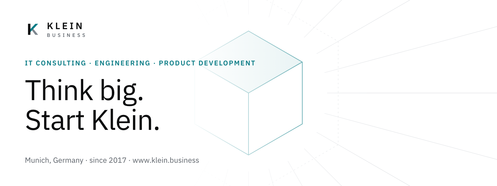
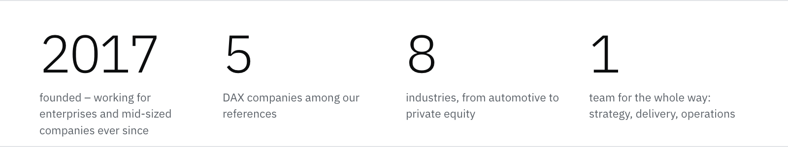
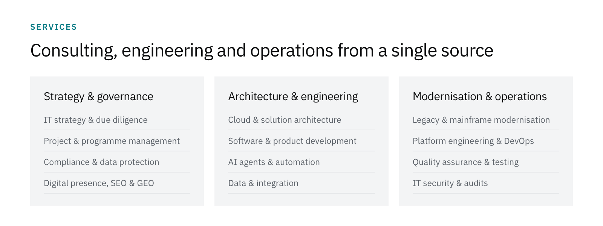
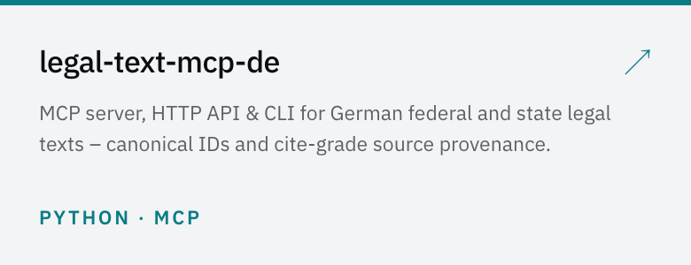
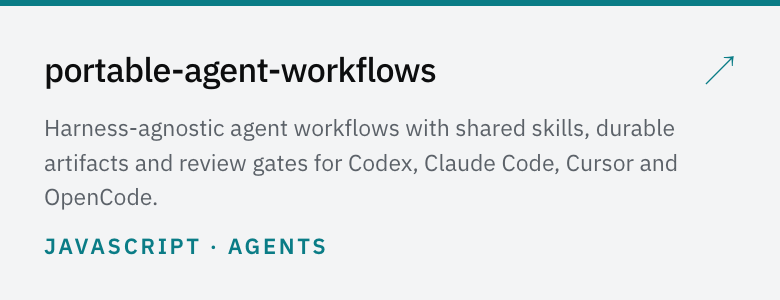
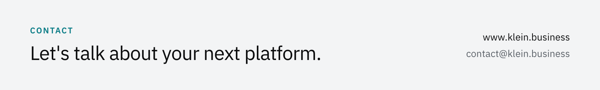

<a href="https://www.klein.business">
  <picture>
    <source media="(prefers-color-scheme: dark)" srcset="./assets/hero-dark.png">
    
  </picture>
</a>

**klein.business** advises and builds for enterprises and mid-sized companies: from IT strategy,
architecture, software and AI to the modernisation of existing systems and their stable operation.
Compliance is part of the architecture, not of the sign-off.

<picture>
  <source media="(prefers-color-scheme: dark)" srcset="./assets/figures-dark.png">
  
</picture>

<picture>
  <source media="(prefers-color-scheme: dark)" srcset="./assets/capabilities-dark.png">
  
</picture>

### Open source

<a href="https://github.com/klein-business/legal-text-mcp-de"><picture>
  <source media="(prefers-color-scheme: dark)" srcset="./assets/oss-legal-text-mcp-de-dark.png">
  
</picture></a>
<a href="https://github.com/klein-business/portable-agent-workflows"><picture>
  <source media="(prefers-color-scheme: dark)" srcset="./assets/oss-portable-agent-workflows-dark.png">
  
</picture></a>

Contributions are welcome – see the [contributing guidelines](https://github.com/klein-business/.github/blob/main/CONTRIBUTING.md)
and the [security policy](https://github.com/klein-business/.github/blob/main/SECURITY.md).

<a href="https://www.klein.business/en/contact/">
  <picture>
    <source media="(prefers-color-scheme: dark)" srcset="./assets/contact-dark.png">
    
  </picture>
</a>
